# Previsão da gravidade de acidentes em rodovias federais com Machine Learning

Projeto final da disciplina **Machine Learning — Práticas e Projetos** (MBA em Ciência de Dados e Inteligência Artificial).

<!-- RESULTADOS_INICIO -->
## Resultados em uma página

**Teste: 72.529 acidentes de 2025**, ano não usado em nenhuma escolha. Cenário A, só com informação disponível no acionamento. Intervalos de confiança de 95% por *bootstrap*.

| Modelo | F1-macro (IC 95%) | Recall Fatais | Precisão Fatais | PR-AUC Fatais | ROC-AUC macro | Acurácia |
| --- | --- | --- | --- | --- | --- | --- |
| Dummy estratificado | 0,334 | 0,072 | 0,073 | 0,072 | 0,500 | 0,618 |
| Regressão Logística (baseline) | 0,543 (0,537–0,547) | 0,382 | 0,375 | 0,316 | 0,768 | 0,747 |
| Random Forest | 0,551 (0,546–0,556) | 0,407 | 0,381 | 0,328 | 0,771 | 0,744 |
| **XGBoost** | **0,561 (0,555–0,566)** | **0,421** | **0,391** | **0,348** | **0,780** | **0,759** |

- **O XGBoost foi o melhor modelo**, escolhido na validação de 2024 (F1-macro 0,561, igual ao do teste). A diferença para o Random Forest e para a Regressão Logística é estatisticamente significativa (McNemar, p < 10⁻²⁴), mas **pequena**: +0,018 de F1-macro sobre o baseline.
- **Acidentes fatais:** o modelo encontra 42% deles com precisão de 39%. A PR-AUC (0,348) é 4,8 vezes a do acaso (0,072). Aceitando precisão de 30%, encontra 55% dos fatais.
- **O tipo de acidente domina a previsão.** Embaralhá-lo derruba a PR-AUC de Fatais em 0,200; a segunda variável, nº de veículos, em 0,050. Sem tipo e sem veículos (cenário B), o F1-macro cai para 0,442.
- **Limite principal:** a regra "fatal se colisão frontal ou atropelamento" sozinha teria F1 de 0,353 na classe Fatais, contra 0,405 do modelo. Fora desses dois tipos o modelo encontra só 8% dos acidentes fatais (242 de 2.912).
- **Vazamento:** acrescentar a causa do acidente (cenário C, informação pós-perícia) eleva o F1-macro para 0,576 (+0,015). É um ganho real, mas inválido para previsão.

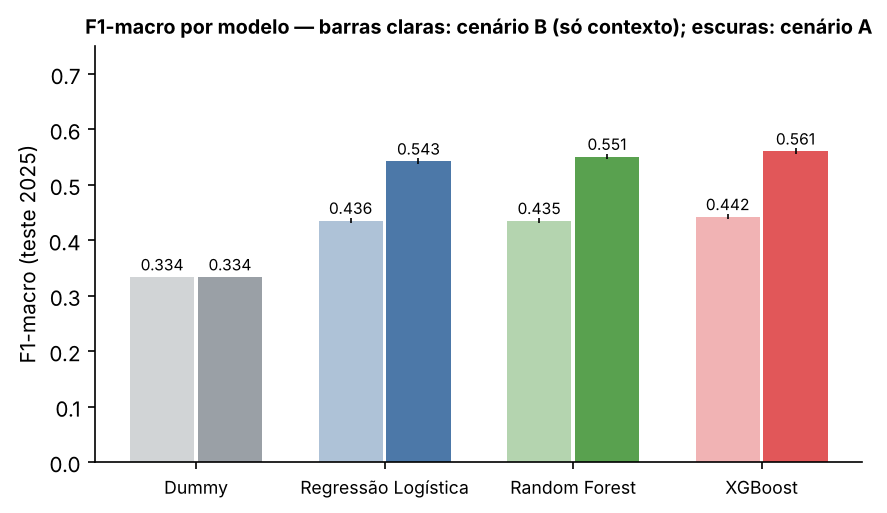

| 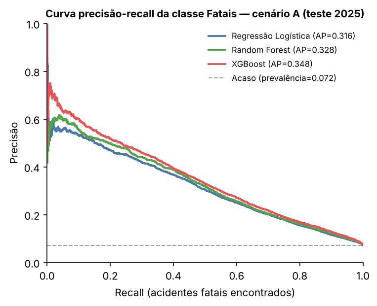 | 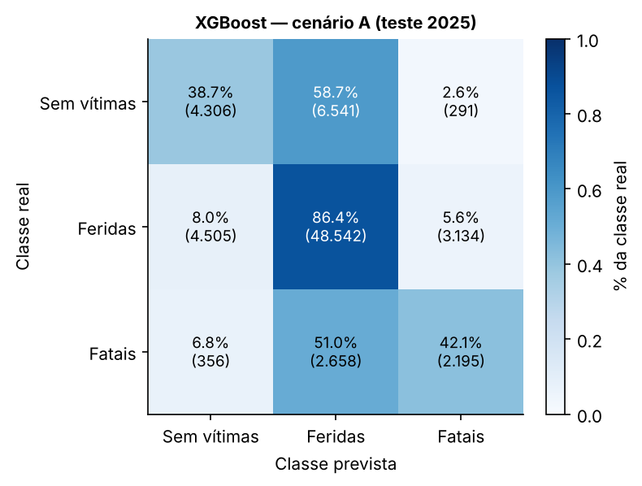 |
| --- | --- |

Tabelas completas: [`reports/resultados.md`](reports/resultados.md) e [`reports/tables/`](reports/tables/).

<!-- RESULTADOS_FIM -->

---

## 1. Problema

**Pergunta:** com as informações disponíveis no momento em que a PRF é acionada (quando, onde, em que via, com que clima, que tipo de acidente e quantos veículos), é possível prever a gravidade de um acidente? Modelos de árvores superam uma Regressão Logística num ano futuro, não usado no treino?

- **Tarefa:** classificação multiclasse com as três classes oficiais de `classificacao_acidente`: *Sem Vítimas*, *Com Vítimas Feridas* e *Com Vítimas Fatais*.
- **Foco:** a classe Fatais (~7% dos acidentes).
- **Aplicação:** apoio à priorização de despacho/resgate e ao planejamento de fiscalização e obras. O modelo é ferramenta de apoio; a decisão continua humana.
- **Canvas de abertura:** [`CANVAS.md`](CANVAS.md) e [`docs/canvas.png`](docs/canvas.png).

## 2. Dados

- **Fonte:** [Dados Abertos da PRF](https://www.gov.br/prf/pt-br/acesso-a-informacao/dados-abertos/dados-abertos-da-prf), arquivo *Agrupados por ocorrência* (`datatran<ano>.csv`), **2017–2025: 632.420 acidentes**, 30 colunas, sem dados pessoais.
- **Procedência dos arquivos usados:** cópias públicas dos CSV oficiais, com hash registrado (ver [`data/README.md`](data/README.md)). `python -m src.data_processing --baixar` baixa da fonte oficial.
- **Viés de seleção:** desde 2015 acidentes sem vítimas podem ser declarados online e saem da base; a composição só se estabiliza em 2019. Por isso o treino começa em 2019 e os resultados valem para **acidentes atendidos pela PRF**.

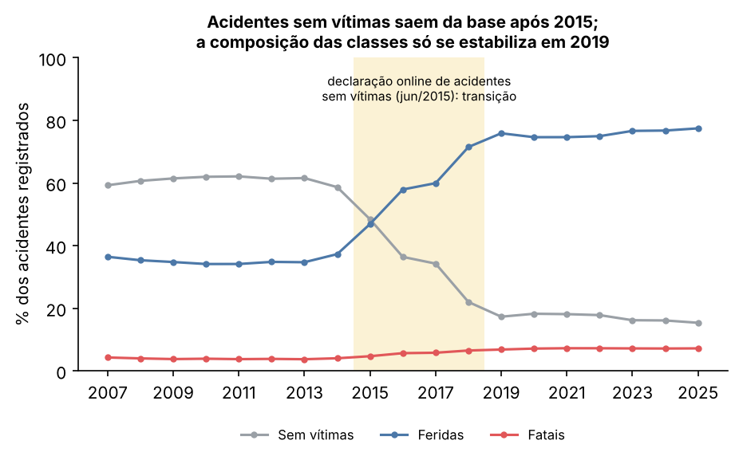

## 3. Metodologia

### Cenários de informação (prevenção de vazamento)

| Cenário | Momento simulado | Variáveis |
| --- | --- | --- |
| **A (principal)** | chamada chega à PRF | tempo, local, via, clima, `tipo_acidente`, `veiculos` |
| B | antes de saber o que aconteceu | tempo, local, via, clima |
| C (**não é previsão**) | após o levantamento | A + `causa_acidente` |
| A + pessoas | sensibilidade | A + `pessoas` |

`mortos`, `feridos`, `feridos_leves`, `feridos_graves`, `ilesos` e `ignorados` **definem o alvo** e nunca entram (há teste automatizado para isso).

### Protocolo

1. **Divisão temporal:** treino 2019–2023 (327.879), validação 2024 (73.156), teste 2025 (72.529).
2. **Janela de treino** (2017, 2019 ou 2021 como início) escolhida na validação.
3. **Busca aleatória de hiperparâmetros** (treino → validação), incluindo a estratégia de pesos de classe (`balanceado`, `raiz`, `nenhum`).
4. **Ajuste do limiar de decisão** na validação (multiplicadores das probabilidades de *Sem Vítimas* e *Fatais*) para maximizar o F1-macro.
5. **Validação cruzada temporal** (origem móvel, 4 folds anuais 2021–2024) para medir estabilidade.
6. **Teste 2025 usado uma única vez** por modelo/cenário, após retreino em 2019–2024.
7. Intervalos de confiança por *bootstrap* (1.000 reamostragens) e teste de McNemar.

**Métrica principal:** F1-macro (as três classes pesam igual; a acurácia premiaria prever sempre "Feridas"). **Apoio:** PR-AUC da classe Fatais (qualidade do ranqueamento, sem depender de limiar).

**Modelos:** Dummy estratificado (piso), Regressão Logística multinomial (baseline), Random Forest (*bagging*) e XGBoost (*boosting*).

## 4. Estrutura do repositório e módulos

```text
projeto-acidentes-ml/
├── README.md                  # este arquivo
├── CANVAS.md                  # canvas de abertura (docs/canvas.png = versão visual)
├── requirements.txt           # versões fixadas
├── .gitignore / .env.example
├── data/
│   ├── README.md              # fonte, procedência, hashes
│   ├── raw/manifest.json      # SHA-256 dos CSV usados (os CSV não vão para o Git)
│   └── external/historico_classes_2007_2025.csv
├── notebooks/                 # executados, com saídas
│   ├── 01_carregamento_dados.ipynb
│   ├── 02_analise_exploratoria.ipynb
│   ├── 03_preparacao_dados.ipynb
│   ├── 04_baseline.ipynb
│   ├── 05_modelagem.ipynb
│   └── 06_avaliacao_modelos.ipynb
├── src/
│   ├── config.py              # caminhos, anos, variáveis por cenário, colunas proibidas
│   ├── data_processing.py     # download, leitura, harmonização e limpeza
│   ├── feature_engineering.py # ColumnTransformers, target encoding, ajuste de limiar
│   ├── train.py               # janela, busca, modelos finais, CV temporal, split aleatório
│   └── evaluate.py            # métricas, bootstrap, McNemar, EDA, figuras, SHAP
├── tests/test_pipeline.py     # leitura, ausência de vazamento, pipeline
├── reports/
│   ├── resultados.md          # gerado por src.evaluate
│   ├── figures/               # todas as figuras
│   └── tables/                # todas as tabelas (CSV/JSON)
├── docs/                      # canvas visual
├── sala/                      # roteiro do pitch
└── relatorio/                 # relatório técnico
```

| Módulo | O que faz | Funções principais |
| --- | --- | --- |
| `config.py` | Define o experimento num só lugar | `CENARIOS`, `features_do_cenario`, `COLUNAS_DESFECHO`, anos de corte |
| `data_processing.py` | Baixa, lê (Latin-1, `;`, decimal variável), harmoniza categorias entre anos, cria atributos linha a linha | `baixar_ano`, `ler_anos`, `limpar`, `construir_base` |
| `feature_engineering.py` | Pré-processamento que aprende com os dados, dentro do `Pipeline` | `preprocessador_linear`, `preprocessador_arvores`, `AjusteLimiar` |
| `train.py` | Protocolo experimental completo | `experimento_janela`, `busca`, `treinar_final`, `validacao_cruzada_temporal`, `experimento_split_aleatorio` |
| `evaluate.py` | Métricas, IC, McNemar, figuras de EDA e resultados, permutação, SHAP, erros por grupo | `metricas`, `bootstrap_ic`, `mcnemar`, `figuras_eda`, `gerar_relatorio` |

## 5. Como executar

```bash
python -m venv .venv && source .venv/bin/activate      # Python 3.11+ (testado em 3.13)
pip install -r requirements.txt

python -m src.data_processing --baixar   # baixa 2017-2025 da PRF e gera o Parquet (~1 min + download)
python -m src.train --etapa tudo         # janela, busca, modelos finais, CV temporal, extras (~1 h em 2 núcleos)
python -m src.evaluate                   # tabelas, figuras e reports/resultados.md (~5 min)
python -m pytest -q                      # testes
```

Os notebooks leem os artefatos gerados acima. Em `04` e `05`, `RETREINAR = True` refaz o treino; em `06`, `GERAR = True` refaz as figuras.

<!-- DETALHES_INICIO -->
## 6. Resultados detalhados

### 6.1 Análise exploratória (2017–2024; o teste de 2025 não foi usado na EDA)

- **Tipo de acidente** é a variável mais associada à gravidade (V de Cramér 0,32). Colisões frontais e atropelamentos de pedestre são fatais em ~28% dos casos; colisões traseiras, em 4%.
- **Pista simples** (9,2% de acidentes fatais), **madrugada/noite** e **área não urbana** (`uso_solo = Não`: 8,6% x 4,4%) concentram a letalidade.
- **Nordeste e Norte** têm a maior proporção de fatais (10,2% e 9,3%); Sul e Sudeste, a menor (5,1% e 5,7%).
- **Chuva tem letalidade menor que céu claro** (5,8% x 7,2%), um lembrete de que taxas descritivas não são efeitos causais.

| 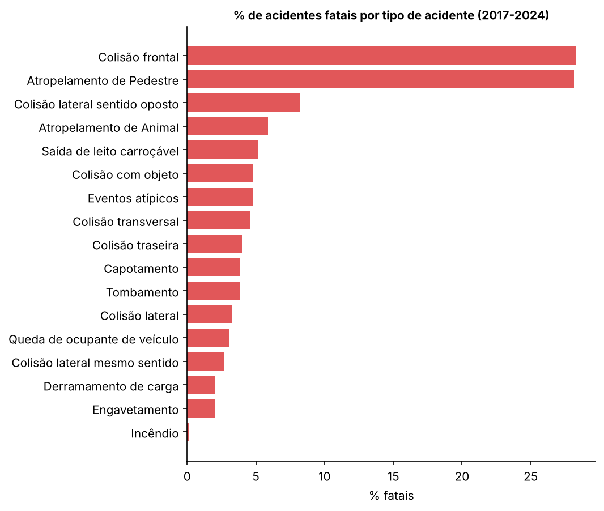 | 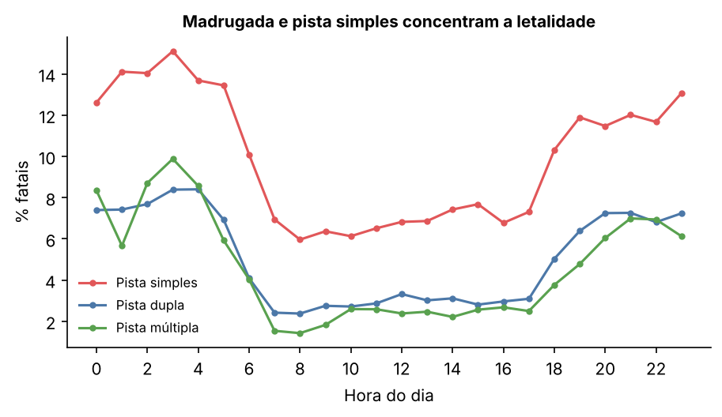 |
| --- | --- |
| 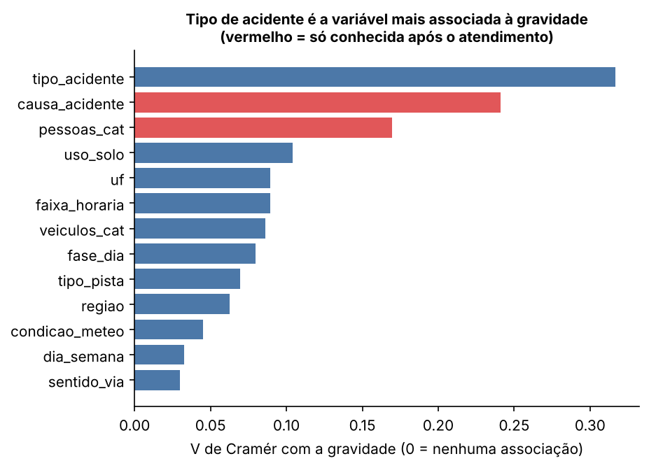 | 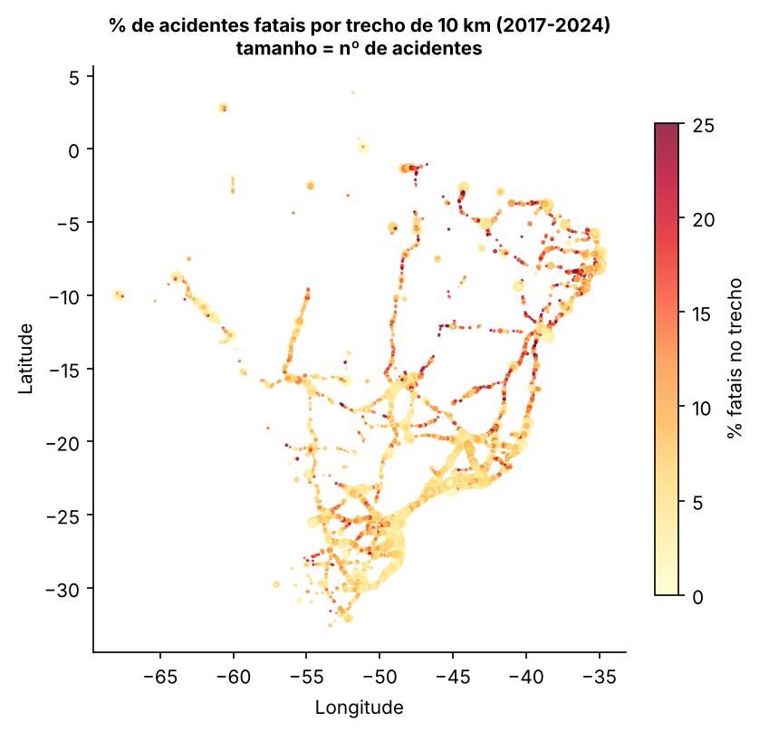 |

### 6.2 Escolhas feitas na validação (2024)

| Escolha | Resultado |
| --- | --- |
| Janela de treino | 2019 (F1-macro 0,559) > 2021 (0,558) > 2017 (0,553). 2017–2018 ainda estão na transição da declaração online. |
| XGBoost | 500 árvores, profundidade 8, *learning rate* 0,03, `subsample` 0,7, `colsample_bytree` 0,8, `min_child_weight` 5, `reg_lambda` 5, pesos balanceados |
| Random Forest | 200 árvores, `min_samples_leaf` 10, `max_features` 0,3, pesos balanceados |
| Regressão Logística | C = 10, sem pesos (o ajuste de limiar compensou o desbalanceamento) |
| Ajuste de limiar (XGBoost) | probabilidades de Sem Vítimas × 0,57 e de Fatais × 0,32. Os pesos balanceados já empurram demais as classes raras, e o limiar corrige o excesso. |

**Validação cruzada temporal** (4 folds anuais, 2021–2024, F1-macro com `argmax`): XGBoost 0,478 ± 0,006; Random Forest 0,494 ± 0,009; Regressão Logística 0,438 ± 0,021. PR-AUC de Fatais: XGBoost 0,324 ± 0,016, RF 0,307 ± 0,016, LR 0,304 ± 0,015. Os modelos são estáveis entre anos, e o desempenho cresce um pouco com mais anos de treino.

### 6.3 Teste 2025: todos os modelos e cenários

| Modelo | Cenário | F1-macro | F1 Sem vítimas | F1 Feridas | F1 Fatais | PR-AUC Fatais | ROC-AUC |
| --- | --- | --- | --- | --- | --- | --- | --- |
| Dummy | A/B | 0,334 | 0,164 | 0,765 | 0,072 | 0,072 | 0,500 |
| Regressão Logística | B | 0,436 | 0,264 | 0,805 | 0,238 | 0,179 | 0,664 |
| Random Forest | B | 0,435 | 0,266 | 0,803 | 0,237 | 0,178 | 0,661 |
| XGBoost | B | 0,442 | 0,290 | 0,787 | 0,250 | 0,189 | 0,667 |
| Regressão Logística | A | 0,543 | 0,404 | 0,845 | 0,378 | 0,316 | 0,768 |
| Random Forest | A | 0,551 | 0,418 | 0,841 | 0,394 | 0,328 | 0,771 |
| **XGBoost** | **A** | **0,561** | **0,424** | **0,852** | **0,405** | **0,348** | **0,780** |
| XGBoost | A + pessoas (sensibilidade) | 0,575 | 0,461 | 0,855 | 0,410 | 0,349 | 0,793 |
| XGBoost | C (com causa: não é previsão) | 0,576 | 0,458 | 0,853 | 0,417 | 0,368 | 0,794 |

**Hipóteses da proposta:**

| Hipótese | Resultado |
| --- | --- |
| H1 — árvores superam a Regressão Logística | **Confirmada, com ganho pequeno** (+0,008 RF, +0,018 XGBoost; McNemar p < 10⁻²⁴) |
| H2 — `tipo_acidente` é a variável mais importante no cenário A | **Confirmada** (permutação e SHAP) |
| H3 — só com contexto (B) o desempenho cai, mas supera o acaso | **Confirmada** (0,442 x 0,334; PR-AUC 2,6 vezes o acaso) |
| H4 — a causa (C) melhora as métricas | **Confirmada, efeito pequeno** (+0,015) |
| H5 — Feridas concentra as confusões | **Confirmada**: 51% dos fatais e 59% dos sem vítimas são previstos como Feridas |
| H6 — variação por região e por ano | **Parcial**: forte entre UFs; pequena entre anos (validação 0,561 = teste 0,561) |

**Split aleatório x temporal:** um split aleatório 80/20 de 2019–2025 deu F1-macro (`argmax`) de 0,487 e PR-AUC de Fatais de 0,336, praticamente igual ao teste temporal (0,485 e 0,348). Nesta base, com *target encoding* feito por *cross fitting*, o split aleatório não inflou as métricas. O protocolo temporal continua sendo o correto, porque é o que simula o uso real.

### 6.4 Interpretação (XGBoost, cenário A)

| 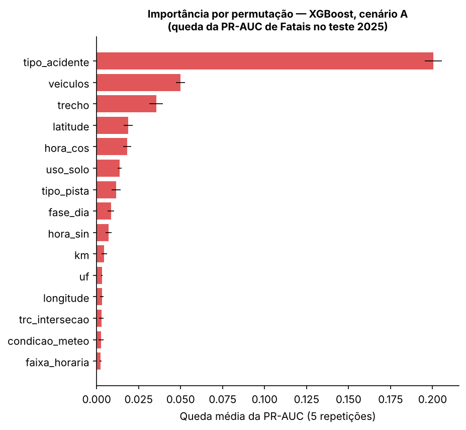 | 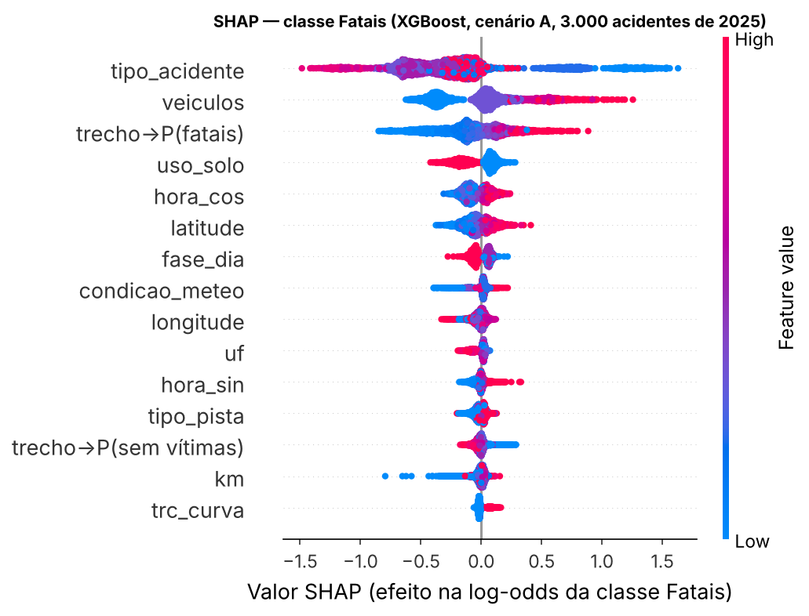 |
| --- | --- |

- **Permutação** (queda da PR-AUC de Fatais): tipo de acidente 0,200; nº de veículos 0,050; trecho 0,035; latitude 0,019; hora 0,018; uso do solo 0,014; tipo de pista 0,012.
- **SHAP:** mais veículos e trechos historicamente letais elevam a probabilidade de acidente fatal; área urbana (`uso_solo = Sim`) a reduz. Na Regressão Logística, atropelamento de pedestre (razão de chances ≈ 9,4) e colisão frontal (≈ 3,7) são os maiores fatores positivos, e incêndio (≈ 0,14) o maior negativo.
- Essas medidas explicam **o modelo**, não as causas dos acidentes.

### 6.5 Erros e vieses

- **Por classe:** Feridas é bem reconhecida (F1 0,852). Sem Vítimas (F1 0,424) e Fatais (F1 0,405) são as mais difíceis, e ambas são confundidas sobretudo com Feridas.
- **Por tipo de acidente:** em colisões frontais e atropelamentos o modelo encontra 85% dos fatais; nos demais tipos, 8%. A informação que distinguiria um tombamento fatal de um não fatal (velocidade, ocupantes, cinto, tipo de veículo) não está nas variáveis do cenário A.
- **Por região/UF:** a PR-AUC de Fatais vai de 0,24 (RN) a 0,53 (CE). O recall de Fatais é maior no Norte (0,52) e Nordeste (0,48) que no Sudeste (0,36), acompanhando a prevalência local.
- **Por período:** o recall de Fatais é 0,31 de dia e 0,51 à noite. Entre os meses de 2025, o F1-macro varia de 0,54 a 0,58, sem tendência.
- **Calibração:** a Regressão Logística (sem pesos) está bem calibrada. O XGBoost e o Random Forest, treinados com pesos balanceados, **superestimam** a probabilidade de acidente fatal e precisam de recalibração antes de o escore ser lido como risco.

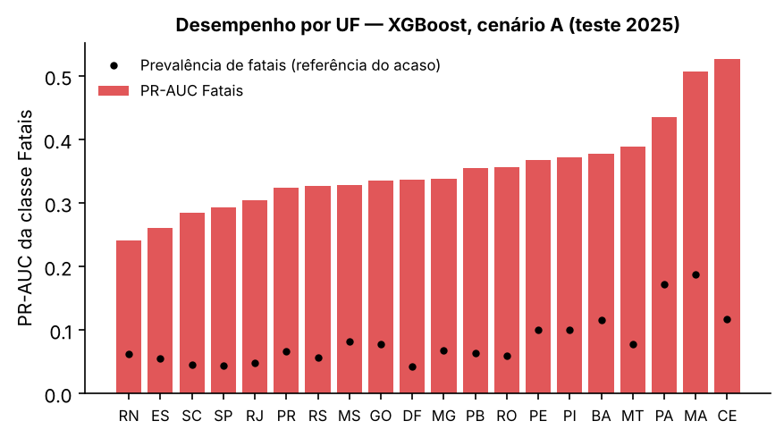

## 7. Conclusões

1. É possível prever a gravidade de acidentes na PRF bem acima do acaso com informação disponível no acionamento. O XGBoost alcança F1-macro de 0,561 e PR-AUC de Fatais de 0,348 num ano futuro.
2. O ganho dos modelos de árvores sobre a Regressão Logística é real, mas pequeno. A Regressão Logística continua competitiva e é mais interpretável e mais bem calibrada.
3. O desempenho vem quase todo do **tipo de acidente**. Sem ele, o modelo só com contexto (tempo, local, via, clima) serve para planejamento, não para triagem individual.
4. Informação pós-acidente (causa, nº de pessoas) melhora pouco as métricas, mas invalidaria o uso como previsão. Separar cenários deixa isso explícito.

## 8. Limitações

- **População:** só acidentes atendidos pela PRF. Os sem vítimas declarados online não estão na base.
- **Rótulo:** óbito apenas no local; mortes posteriores contam como feridos.
- **Medição:** clima e traçado são anotados pelo policial; o traçado mudou de padrão em 2022. Na base, o tipo de acidente é o registrado depois do atendimento, e numa chamada real pode ser menos preciso.
- **Procedência:** os CSV vieram de cópias públicas dos arquivos oficiais (ver [`data/README.md`](data/README.md)). Recomenda-se rodar `--baixar` para conferir.
- **Escopo:** sem dados de veículo, velocidade ou fluxo, que são temas para o TCC.

## 9. Ponte para o TCC

Pergunta proposta: *a integração de clima medido (INMET), características da via (DNIT) e tipos de veículo envolvidos melhora a identificação de acidentes fatais fora dos tipos já reconhecidos (frontal e atropelamento), e permite apontar trechos críticos estáveis entre anos?* Extensões: recalibração das probabilidades, pareamento com mortes em 30 dias (SIM/DATASUS), modelos espaço-temporais por trecho e painel interativo para gestores.

<!-- DETALHES_FIM -->

## Licença e uso

Código sob licença MIT. Dados: Polícia Rodoviária Federal, dados abertos. Este modelo é um exercício acadêmico e não deve ser usado para negar ou reduzir atendimento a nenhuma ocorrência.
